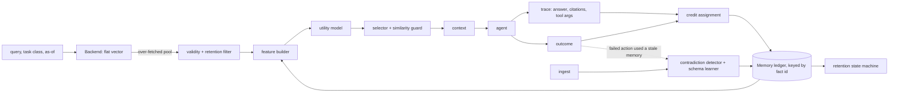

# ReMem: outcome-aware adaptive memory for long-horizon AI agents

ReMem is a memory layer that learns **which memories actually help an agent succeed**, and uses that to decide what to
retrieve, what to keep, what to supersede, and how much context to spend. It sits on top of a retrieval backend (a flat
vector index is built in; any backend implementing `remem.backends.base.Backend` can be plugged in).

> **Status: research prototype.** All numbers below come from a *synthetic, controlled benchmark with a simulated agent and an
> offline hash-based embedder*, not from a real LLM agent or a public memory benchmark. See [§11 Limitations](#11-limitations-read-these).
>
> **Novelty:** citation-based feedback on retrieval is prior art (RMM, arXiv 2503.08026, refines retrieval with online RL from the LLM's cited
> evidence), and Zep and Mem0's graph variant already keep superseded facts as invalid instead of deleting them. ReMem's contribution is the
> combination plus a controlled evaluation, not any single idea. See [docs/RELATED_WORK.md](docs/RELATED_WORK.md).

## What it adds to a retrieve-by-similarity memory

| Gap in a retrieve-by-similarity memory | ReMem's mechanism | Measured effect (this benchmark, 5 test seeds) |
|---|---|---|
| similarity is the only signal; look-alikes that never help keep winning | per-memory outcome ledger + utility model (transparent heuristic or learned logistic regression) | +13.3 pp task success over similarity-only retrieval, −9.6 tokens/task |
| replaced facts stay retrievable | supersession with validity intervals, `as_of` queries, outcome-triggered invalidation | stale-fact-in-context 40–57% → 0%; historical queries keep working |
| no safe way to retire or shrink memory | explicit state machine `ACTIVE → LOW_VALUE → COMPRESSED → ARCHIVED`, `INVALIDATED`; nothing deleted | safe for rarely-needed memories where frequency pruning destroys them (80% → 7.5% success) |
| context cost ignored | expected-utility knapsack under a token budget | −9.6 tokens/task; +1.6 pp from this step alone |
| correct memories sometimes pushed out by the utility layer | similarity guard | targeted failure 2.0% → 0.7% of tasks; **no change in success** |
| single-valued attributes must be declared by hand | schema learned from outcome evidence | recovers most of the gap when no schema is given |
| credit assignment is cheap but imprecise | leave-one-out only on ambiguous memories | 83.7% vs 77.9% success for 0.43 extra agent calls/task |
| simulated agent only | OpenAI-compatible agent + embedder adapters | **unverified**: tested against fake clients only |

## Quickstart

```bash
pip install .            # Python 3.10+; dependencies: numpy, pyyaml, matplotlib
python examples/quickstart.py
```

```python
from remem.backends import StoredFact, VectorBackend
from remem.system import ReMemSystem, IngestedFact
from remem.types import AgentTrace, Outcome

backend = VectorBackend(embedder)                  # any Backend: returns candidates for a query
memory = ReMemSystem(config, embedder)             # configs/systems.yaml or remem.config dataclasses

backend.ingest([fact]); memory.ingest(IngestedFact(...))          # 1. store
pool, _ = backend.candidates(question, k=20)                      # 2. over-fetch candidates
ctx = memory.retrieve(task_id, question, pool, task_class="api", now=t)   # 3. ReMem ranks + selects
# ... your agent answers using [s.text for s in ctx.selected] ...
memory.observe(ctx, AgentTrace(answer, cited_ids, tool_args), Outcome(success))  # 4. feedback
```

[`examples/quickstart.py`](examples/quickstart.py) is the runnable version: a fact that is superseded by a migration stops being
served, a look-alike note that never helps is demoted to `LOW_VALUE`, and the current fact accumulates credit.

## Contents
1. [Problem](#1-problem) · 2. [Architecture](#2-architecture) · 3. [Utility model](#3-memory-utility-model) · 4. [Outcome feedback and credit assignment](#4-outcome-feedback-and-credit-assignment) · 5. [Adaptive retention](#5-adaptive-retention) · 6. [Contradiction and staleness](#6-contradiction-and-staleness) · 7. [Cost-aware retrieval](#7-cost-aware-retrieval) · 8. [Additional mechanisms](#8-additional-mechanisms) · 9. [Evaluation methodology](#9-evaluation-methodology) · 10. [Results](#10-results) · 11. [Limitations](#11-limitations-read-these) · 12. [Failure analysis](#12-failure-analysis) · 13. [Future work](#13-future-work) · [Related work](docs/RELATED_WORK.md)

## 1. Problem

Long-horizon agents accumulate thousands of memories. Which to show, keep, shrink or retire depends on whether they
*help the agent succeed*, which similarity cannot tell you: a memory can be close to every query and never useful; another can be
rarely needed and indispensable; a third can be correct once and false after a migration.

## 2. Architecture



| Module (`remem/`) | Role |
|---|---|
| `ledger.py`, `types.py` | per-memory state, statistics, validity, lifecycle events; JSON persistence |
| `features.py`, `utility.py` | feature groups; transparent heuristic and L2 logistic regression |
| `attribution.py` | credit assignment: presence / signals / signals + leave-one-out (all or ambiguous-only) |
| `contradiction.py` | supersession, validity intervals, volatile-attribute confidence decay, outcome-triggered invalidation, schema learning |
| `retention.py` | the state machine and revival |
| `selection.py`, `system.py` | rank packing vs knapsack; `ReMemSystem.ingest / retrieve / observe`; guard and exploration |
| `backends/` | `Backend` protocol and the flat-vector backend |
| `offline.py` | deterministic hash embedder with synonym lexicon (offline benchmark/tests) |
| `eval/` | seeded world generator, simulated agent, runner, metrics, failure analysis, report |
| `llm.py` | OpenAI-compatible agent and embedder adapters (unverified, see §8) |
| `viz/ledger_cli.py` | developer inspector |

## 3. Memory utility model

Target: `P(memory contributes to a successful outcome | features at retrieval time)`. Four feature groups let ablations switch
information sources off: **static** (similarity, gap to best, backend rank, recency, confidence, token cost), **history**
(retrieval count/recency, the "frequency" strawman), **outcome** (Beta-posterior contribution rate overall and per task class,
waste rate, blame rate, posterior std), **contradiction** (stale flag, contradiction count).

* `HeuristicUtility`: documented weighted sum (weights are design choices, listed in `utility.py`).
* `LearnedUtility`: L2 logistic regression (numpy Newton/IRLS, deterministic) trained on traces from **disjoint training worlds**; labels
  are *observed* (attributed credit ≥ 0.5 on a successful task), never ground truth; regularisation by leave-one-seed-out CV
  (`results/models/train_report.json`).
* Exploration: `+ c·posterior_std` (UCB-style) by default; Thompson sampling is available (§8).

## 4. Outcome feedback and credit assignment

`retrieve → agent acts → success/failure → credit assignment → ledger update → retention`. Only **shown** memories receive feedback
(bandit feedback), so retention reacts to evidence of uselessness *when shown*, never to low retrieval frequency.

Credit uses observable signals only: whether the agent **cited** the memory (self-reported, noisy) and whether the memory
**contains a value the agent committed to**. Credit is per memory (not split equally); failures assign *blame* to memories whose
value was used. Optional **leave-one-out replay** upgrades memories whose removal flips success to failure. Stated limitations:
citations are self-reported; value use is lexical (a decoy mentioning the answer counts); LOO needs a replayable agent and
under-credits redundant copies; none of it establishes causality.

## 5. Adaptive retention

States `ACTIVE, LOW_VALUE, COMPRESSED, ARCHIVED, INVALIDATED`; every transition is logged with its reason; nothing is deleted
(`original_text` is kept). Transitions depend on the posterior contribution rate and the number of *exposures*; demotions apply
per task class ("useless for deploys" ≠ "useless for approvals"); credited use revives; memories with accumulated credit cannot be
archived. A frequency-prune **control** exists only to show what this design avoids.

## 6. Contradiction and staleness

At ingest, two state-asserting facts conflict when they share an `(entity, attribute)` key and differ in *value-bearing* tokens.
Single-valued attributes supersede on key match; otherwise explicit update wording ("migrated", "no longer") is required. The old
fact gets `valid_to` and state `INVALIDATED`; it is excluded from default retrieval but returned for historical `as_of`
queries. A failed action that used memory M while a newer same-key fact exists supersedes M (outcome-triggered). Confidence decays
only for attributes observed to change, so old-but-true facts are not punished for age.

## 7. Cost-aware retrieval

Candidates with predicted `p < p_floor` are not worth context; under a hard token budget an exact 0/1 knapsack maximises Σp subject
to count and token limits. Tokens are a word+punctuation proxy, not a real tokenizer. Additivity of expected utility is an
approximation (a task needing two memories only succeeds with both).

## 8. Additional mechanisms

Each was tested and measured; results (including those that did not help) are in §10.

1. **Similarity guard** (`selection.guard_top`, default 3): the top-m most similar candidates are always served unless the ledger has
   evidence they are useless for this task class (shown ≥ 3 times, class contribution rate < 0.2). Targets a measured failure: the
   utility layer pushing a correct, highly similar memory out of context. `guard_top=3` was chosen on dev seeds.
2. **Thompson sampling** as an alternative exploration rule (`utility.explore_mode: thompson`). **Worse than the default UCB bonus**
   at every strength tried, so it is not the default.
3. **Learned single-valued-attribute schema** (`contradiction.learn_schema`): an attribute becomes single-valued after ≥ 2 outcome
   confirmations (failed actions that used a stale value, or explicit replacement wording) with posterior ≥ 0.6; counter-evidence
   (an older value still credited after a newer one arrived) blocks it. Pending conflicts are superseded retroactively.
4. **Cheaper leave-one-out** (`attribution.loo_policy: ambiguous`): replay only memories where exactly one of cited/used holds.
5. **LLM adapters** (`remem/llm.py`, `experiments/run_llm_agent.py`): `LLMAgent` (OpenAI-compatible chat, JSON answers + citations) and
   `OpenAIEmbedder`. **Not verified against a live endpoint**; covered by fake-client unit tests only. No reported number uses them.

## 9. Evaluation methodology

* **Shared candidate pool.** Every system consumes the identical over-fetched pool per query (replayed from a cache); differences come
  only from ranking, selection and lifecycle. Reported latency = pool time + the system's own re-ranking time.
* **Systems.** A flat vector, similarity only · B flat vector + static score (similarity + recency + confidence) · C ReMem ·
  cumulative ablation · leave-one-out · attribution variants · retention control.
* **Tasks** (`remem/eval/world.py`, seeded; ground truth hidden from the memory layer): `distractor`, `long_horizon`, `contradiction`,
  `rare_critical` (dormant and shown-elsewhere critical memories), `useless_frequent`, `budget_tight`/`budget_medium`, `state_change`
  (with historical `as_of` queries), and a **control**, `distractor_norecur`, where no (entity, attribute) pair recurs so per-memory
  history cannot help.
* **Agent.** A deterministic *simulated* reader with position-biased (`first`) and timestamp-aware (`latest`) modes, distraction
  proportional to irrelevant context, chance-level guessing and noisy self-citation. Everything is reported for both modes.
* **Seeds.** Train 100–103 (fit utility model), dev 200–201 (sanity checks and choosing `guard_top`), **test 0–4 (all reported numbers)**.
  Means with 95% t-intervals over seeds; paired differences over seeds. The whole pipeline is deterministic.

```bash
python -m pip install -r requirements.txt
python -m pytest tests -q                      # 57 tests, a few seconds
python experiments/run_benchmark.py --quick    # smoke run
python experiments/run_benchmark.py            # full protocol; trains the model if missing (~2 min, 12 workers)
python experiments/demo_ranking.py             # "more similar vs more useful" demonstration
python -m remem.viz.ledger_cli results/runs/distractor_seed0_C_remem/ledger.json --list --state LOW_VALUE
```

## 10. Results

5 test seeds, mean ± 95% t-interval, simulated agent, offline hash embedder. Full generated tables:
[`results/RESULTS.md`](results/RESULTS.md); aggregates: `results/{baseline,static,remem,ablation,new_features,sensitivity}.json`; plots: `results/plots/`.

### Headline (mean over 7 core families)

| System | Task success % (reader `first`) | (`latest`) | Gold recall % | Context precision % | Tokens/task | Latency ms |
|---|---:|---:|---:|---:|---:|---:|
| A flat vector, similarity only | 64.6 ± 6.1 | 74.0 ± 5.4 | 85.9 | 18.2 | 47.8 | 0.7 |
| B flat vector + static score | 68.0 ± 7.0 | 74.1 ± 5.3 | 86.0 | 18.2 | 47.8 | 1.2 |
| **C ReMem** | **77.9 ± 4.4** | **77.9 ± 4.4** | 90.0 | 21.6 | **38.2** | 1.6 |

Paired over seeds: C − A = **+13.3 ± 2.4 pp** (`first`), **+4.0 ± 1.6 pp** (`latest`); C − B = +9.9 ± 3.0 / +3.9 ± 1.7 pp; tokens −9.6 ± 2.2 per
task. The ReMem layer adds ≈ 1 ms per query over the static-score variant.

**Read the `first`/`latest` gap before the headline.** A timestamp-aware reader already copes with most stale facts, so the gain
shrinks from 13.3 to 4.0 pp. Most of the `first`-reader gain is contradiction handling.

### Per family (task success %, reader `first`)

| System | distractor | long_horizon | contradiction | rare_critical | useless_frequent | budget_tight | state_change | *distractor_norecur (control)* |
|---|---:|---:|---:|---:|---:|---:|---:|---:|
| A similarity only | 76.0 | 77.7 | 53.4 | 76.7 | 77.9 | 49.3 | 41.5 | 70.6 |
| B + static score | 75.9 | 77.6 | 62.2 | 76.7 | 77.9 | 49.3 | 56.4 | 70.6 |
| **C ReMem** | 79.7 | 81.9 | 81.0 | 81.8 | 79.9 | 58.3 | 82.9 | **70.9** |

Per-family intervals are wide (±3.7 to ±19 pp with 5 seeds); on `distractor`, `rare_critical`, `useless_frequent` and `budget_tight` ReMem's
interval overlaps the baselines'. On the control, where history cannot help, **ReMem gives no gain (70.9 vs 70.6)**. `budget_tight` is capped
for every system by long gold facts whose diluted similarity ranks them ~10th and whose 44 tokens nearly fill the 45-token budget.

### Cumulative ablation (reader `first`, core families)

| System | Task success % | Tokens/task | Gold recall % |
|---|---:|---:|---:|
| flat vector baseline | 64.6 ± 6.1 | 47.8 | 85.9 |
| + temporal relevance | 68.0 ± 7.0 | 47.8 | 86.0 |
| + utility score (heuristic, retrieval-history features) | 66.3 ± 6.8 | 47.3 | 85.4 |
| + learned utility model (static + retrieval-history features) | **63.1 ± 5.8** | 47.1 | 80.0 |
| + outcome feedback | 67.8 ± 6.0 | 43.2 | 86.2 |
| + adaptive retention | 68.1 ± 5.8 | 41.9 | 86.7 |
| + contradiction handling | 76.2 ± 4.1 | 42.0 | 90.1 |
| + cost-aware selection (= full without similarity guard) | 77.5 ± 4.1 | 37.7 | 89.1 |

* **Retrieval frequency is not usefulness: measured.** Retrieval-history features, heuristic or learned, *lower* success (66.3, 63.1): in
  training traces frequently retrieved memories are mostly useful, so the model learns "frequent ⇒ useful", and look-alike traps are frequent too.
* Outcome-derived signals repair this (+4.7 pp, −3.9 tokens). **Contradiction handling is the largest single step (+8.1 pp)**, concentrated in
  the two families with updates. Leave-one-out from the full system agrees: removing contradiction handling −8.8 pp, outcome feedback −4.6,
  cost-aware selection −1.6, adaptive retention −1.3 (not significant); removing the similarity guard changes success by +0.4 in the other
  direction (within noise).
* **The learned model does not beat the transparent heuristic.** Full system with the heuristic utility: 78.8 ± 3.9 (learned 77.9 ± 4.4); AUC
  0.964 vs 0.960. The learned model's advantage is calibration (Brier 0.069 vs 0.093, ECE 0.153 vs 0.217), which matters for the cost-aware
  threshold, not ranking. AUC over considered candidates is 0.960 vs 0.903 for similarity alone.

### Credit assignment (same system, different attribution; reader `first`)

| Attribution | Task success % | Credit precision | Credit recall | Extra agent calls/task |
|---|---:|---:|---:|---:|
| presence (equal credit to everything in context) | 73.3 ± 5.3 | 0.20 | 1.00 | 0 |
| usage signals only, **outcome ignored** | 79.5 ± 4.0 | 0.50 | 1.00 | 0 |
| **signals (default)** | 77.9 ± 4.4 | 0.48 | 1.00 | 0 |
| signals + leave-one-out, all memories | 84.0 ± 4.1 | 1.00 | 0.82 | 2.40 |
| **signals + leave-one-out, ambiguous only** | **83.7 ± 4.1** | 0.99 | 0.97 | **0.43** |

Equal credit is worse than signal-based credit (73.3 vs 77.9). **Honest caveat on the name:** crediting purely from citation/value use while
ignoring success/failure scores the same as the default (79.5 vs 77.9, within noise): the benefit here comes from *usage* signals; the success
bit gates credit and drives blame and outcome-triggered invalidation, but we could not show it adds measurable accuracy. Flipping 10% or 20% of
outcome labels leaves ReMem at 78.0 / 78.3, consistent with that.

### Retention (`rare_critical`, reader `first`)

| System | Overall % | Dormant-critical % | Shown-elsewhere critical % | memories ARCHIVED |
|---|---:|---:|---:|---:|
| A similarity only (no retention) | 76.7 | 80.0 ± 13.9 | 75.0 ± 24.5 | 0 |
| C ReMem (adaptive retention) | 81.8 | 80.0 ± 13.9 | 75.0 ± 24.5 | 0.2 |
| **frequency-prune control** | 77.8 | **7.5 ± 13.9** | **22.5 ± 13.0** | **120.0** |

Frequency pruning archives about 58% of memory and destroys the rarely needed ones; the exposure/outcome-based policy leaves them untouched.
Critical tasks are few (8 + 8 per world), so intervals are wide. Adaptive retention itself engages rarely in these worlds (on average 5.6 LOW_VALUE,
0.4 COMPRESSED, 0.3 ARCHIVED of 207) and saves about 2% of eligible tokens; **no accuracy benefit is claimed.**

### Contradiction and state change (reader `first`)

ReMem removes stale-memory-in-context events (`contradiction` 40.3% → 0.0% of tasks; `state_change` 56.5% → 0.0%), with **0 false invalidations**
(multi-valued `depends_on` facts are never superseded), and **0 missed** given the single-valued-attribute schema. Historical (`as_of`) queries:
79.6% vs 47.8% for similarity-only. With 20% of facts losing their attribute key (imperfect extraction) ReMem still reaches 71.6% vs 48.5% for
similarity-only (static score: 59.2%) on the two update families.

**Learned schema (none given), 5 seeds.** Stale-in-context task rate / missed invalidations / success:

| Setting | no schema | learned schema | schema given |
|---|---:|---:|---:|
| `state_change`, explicit update wording | 5.9% / 1.4 / 79.1 | 2.4% / 0.2 / 81.7 | 0.0% / 0 / 82.9 |
| `state_change`, **no** update wording | 11.4% / 5.2 / 79.1 | 2.6% / 0.2 / 82.6 | 0.0% / 0 / 84.1 |
| `contradiction`, explicit wording | 2.8% / 1.2 / 79.8 | 1.6% / 0.6 / 80.3 | 0.0% / 0 / 81.0 |
| `contradiction`, no wording | 5.3% / 1.8 / 76.9 | 4.2% / 0.4 / 77.4 | 0.0% / 0 / 77.0 |

Learning recovers most of the gap where it is largest (`state_change` without wording: +3.5 pp, 96% of the missed invalidations removed) and is
within noise on `contradiction`. It never produced a false invalidation.

### Guard and exploration (core families, reader `first`)

| System | Task success % | Tasks where utility pushed out a top-5-similar gold % | Tokens/task |
|---|---:|---:|---:|
| A similarity only | 64.6 | 0.3 | 47.8 |
| full without guard | 77.5 ± 4.1 | **2.0** | 37.7 |
| **C ReMem (guard_top=3)** | 77.9 ± 4.4 | **0.7** | 38.2 |
| full with Thompson instead of UCB | 76.3 ± 3.7 | 1.0 | 40.4 |

The guard does what it was built for (that failure drops by ~65%) but **does not improve task success**: the memory it swaps in is as often a
look-alike as the correct one. Thompson sampling is worse than UCB (−1.6 pp, +2.1 tokens/task).

### Robustness (core families, `first`)

| Perturbation | A | B | C |
|---|---:|---:|---:|
| none | 64.6 | 68.0 | 77.9 |
| agent not distracted by irrelevant context (0 per item) | 75.2 | 79.0 | 89.3 |
| agent twice as distractible (0.10 per item) | 52.4 | 55.4 | 65.5 |
| 20% of outcome labels flipped | 64.6 | 68.0 | 78.3 |

The absolute level moves a lot with the assumed cost of wasted context; ReMem's lead over similarity-only does not (+14.1 / +13.1 pp).

### Ranking demonstration and lifecycle

`python experiments/demo_ranking.py` writes `results/demo_ranking.md`: tasks where a look-alike with higher similarity is **not** served while a
lower-similarity gold memory is (104 such tasks in the first test world), with both memories' similarity, outcome history and utility components.
`python -m remem.viz.ledger_cli <ledger.json> --id <fact_id>` shows content, utility, retrieval and outcome history, state, contradictions, last
update, why it was retrieved, and a lifecycle line such as `CREATED -> RETRIEVED -> NO_CONTRIBUTION ... [RETRIEVED x12, NO_CONTRIBUTION x9] ; STATE_CHANGE: ACTIVE -> LOW_VALUE ; utility 0.58 -> 0.31 (DOWN)`.
Per-feature "utility components" in these explanations come from a regression with correlated features, so individual component signs can be
large and opposite (e.g. `contrib_rate` −2 against `class_rate` +3); read them as a decomposition of the score, not as independent effects.

## 11. Limitations (read these)

* **No real-LLM and no public-benchmark evidence.** No LoCoMo/LongMemEval-style run was possible (no model endpoints or data available);
  **no number in this repository is from such a benchmark.** The reader is deterministic and simulated; its distraction strength
  (0.05 per irrelevant item) and chance-guessing are assumptions, and the cost-aware gain depends on "wasted context hurts". The LLM adapters are
  untested against a live model.
* **Offline hash embedder.** Hash embeddings with a hand-written synonym lexicon replace a trained embedding model; retrieval quality under real
  embeddings may differ. About 2.5% of gold facts are never retrieved at all (the embedder has no stemming).
* **Only a flat vector backend is built in.** An earlier version also compared against a hierarchical-memory backend; that backend and every
  comparison against it were removed from this repository, so no claim here concerns any hierarchical memory system.
* **Synthetic, author-designed tasks.** They exercise the mechanisms and some (traps, repeated pairs) favour per-memory history by construction; the
  control family and the negative results are included for that reason. Gains require *recurring* queries.
* **Extraction is assumed.** The detector uses `entities`, `attribute_keys` and `semantic_role` fields as an LLM extractor would emit; here they
  come from the generator (noise sensitivity above). The single-valued schema is configuration unless learned (§8.3).
* **Feedback only on shown memories** (bandit feedback); exploration is a heuristic; memories never shown never get labels.
* **Credit assignment is not causal.** Default credit precision is only 0.48; leave-one-out fixes it at a cost of extra agent calls (0.43–2.40/task).
* **The learned model does not beat the heuristic**; it was trained on observed labels from a heuristic policy and deployed under another (distribution shift).
* **Several mechanisms did not help or are within noise:** retention (accuracy), similarity guard (success), Thompson sampling (worse), outcome gating
  (usage-only matches it).
* **Statistics.** 5 seeds; most per-family differences are not individually significant. Tokens are a word+punctuation proxy.
* **Process disclosure.** Hyper-parameters were set a priori. Dev seeds were used for sanity checks, for fixing defects found by unit tests (detector
  false positives, an LOO discount equal to the threshold, trap invalidation by the outcome path), for raising critical tasks per world from 6+6 to 8+8,
  and for choosing `guard_top=3` and rejecting Thompson sampling. The test seeds were run several times as the code changed; the reported numbers are
  from the final run only.

## 12. Failure analysis

[`results/failure_analysis.md`](results/failure_analysis.md) (+ `failures.jsonl`): per-task tags, all test seeds, reader `first`.

| Category | A similarity only | C ReMem |
|---|---:|---:|
| `gold_not_in_pool` (backend never offered it) | 2.5% | 2.5% |
| `gold_pooled_not_selected` | 15.5% | 9.5% |
| `utility_demoted_gold` (top-5 by similarity, pushed out) | 0.2% | 0.6% |
| `useful_filtered` (archived/invalidated although needed) | 0 | 0 |
| `irrelevant_retrieved` (failed + distracted) | 17.6% | 15.4% |
| `outdated_preferred` | 9.8% | **0.0%** |
| `success_without_memory` (lucky guess) | 3.3% | 2.2% |
| `fail_despite_gold` (all gold served, still failed) | 21.6% | 13.2% |

What the system still gets wrong: (1) it demotes correct memories slightly more often than the baseline (0.6% vs 0.2%, down from 2.0% without the
guard); (2) irrelevant context still causes 15% of failures; (3) 2.5% of gold facts are never in the pool, a limitation of the offline embedder;
(4) about one task in eight fails with every needed memory present, because the simulated agent can be distracted.

## 13. Future work

Run the layer against real LLM agents and public memory benchmarks with a task-success signal; replace the simulated reader with an LLM and measure how
well self-citation tracks real dependence; proper off-policy correction for the learned model; add backends for other memory systems; verify the
related-work claims against the original papers ([`docs/RELATED_WORK.md`](docs/RELATED_WORK.md)).

## Repository map

```
remem/         the library                      configs/systems.yaml   every compared system
experiments/   run_benchmark.py, train_utility.py, demo_ranking.py, run_llm_agent.py
tests/         57 tests                          examples/   quickstart.py
.github/       CI: tests on Python 3.10-3.13 + benchmark smoke run
results/       RESULTS.md, failure_analysis.md, *.json, plots/, runs/<…>/ledger.json, models/, records/
docs/          DESIGN.md (design note), RELATED_WORK.md
```

License: MIT (see `LICENSE`). © 2026 Viswesh Kesarla.

## Acknowledgement

Motivated by gaps observed in the MemForest agent-memory system (Chen et al.): https://github.com/Concyclics/MemForest
