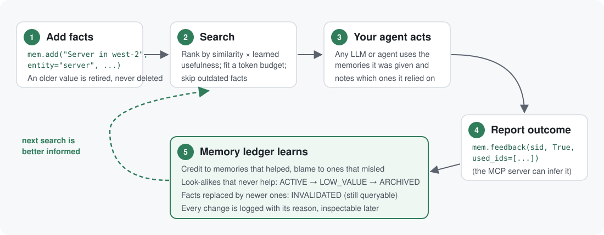
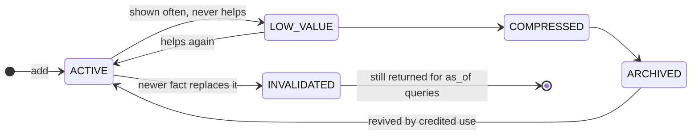
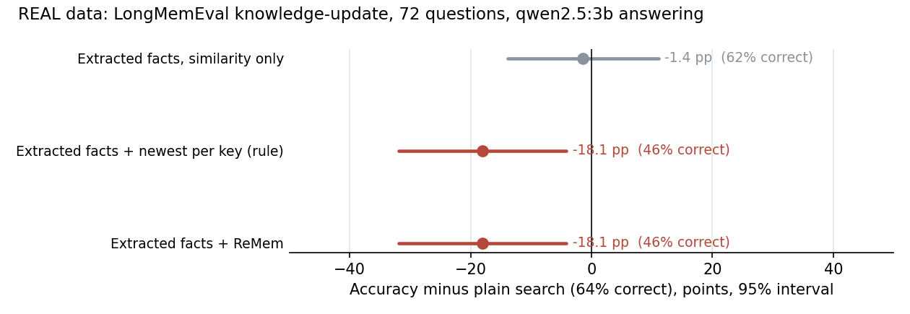
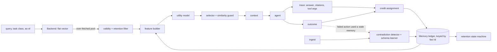

<p align="center">
  
</p>

<p align="center">
  
  
  <a href="https://github.com/visweshdev/ReMem/actions/workflows/tests.yml"></a>
  
  
  
</p>

<p align="center">
  <a href="#quickstart">Quickstart</a> ·
  <a href="#how-it-works">How it works</a> ·
  <a href="#results-at-a-glance">Results</a> ·
  <a href="#use-it-with-claude-mcp">MCP</a> ·
  <a href="#11-limitations-read-these">Limitations</a> ·
  <a href="docs/DESIGN.md">Design</a>
</p>

Most agent memories retrieve whatever *sounds* most similar to the question. That breaks in two everyday ways: a look-alike
note that never helps keeps winning, and a fact that was replaced last week is served right next to its replacement.

**ReMem is a memory layer that learns from outcomes.** After each task you tell it whether the task worked and which
memories helped. It uses that to rank what helps higher, retire what was replaced, demote what never helps, and spend fewer
tokens. Nothing is ever deleted, and every decision can be inspected.

<p align="center">
  
</p>
<p align="center"><sub>Real output of <a href="examples/basic_api.py"><code>examples/basic_api.py</code></a>: the outdated fact is retired, and the note that never helps is demoted to <code>LOW_VALUE</code>.</sub></p>

> [!IMPORTANT]
> **Research prototype.** On LongMemEval's knowledge-update questions, ReMem 0.2 answered **45.8%** correctly vs
> **63.9%** for plain search over raw chat. Rule-based fact replacement on LLM-extracted keys retired correct facts.
> On LongMemEval retrieval it ties the recency baseline. A separate [LoCoMo feedback ablation](docs/FEEDBACK_ABLATION.md)
> measures whether prior outcomes help on held-out questions about the same conversations.

## Quickstart

▶ **New to this? Watch the install video (under 1½ minutes):** [`docs/video/install_and_run.mp4`](docs/video/install_and_run.mp4)
(clone, install, run the demo, try the `remem` shell, use it in your own code, run the tests; every output in it is from a real run).

```bash
git clone https://github.com/visweshdev/ReMem.git
cd ReMem
pip install -e .                 # core needs only numpy and pyyaml
python examples/basic_api.py     # the demo above
```

```python
from remem import ReMem

mem = ReMem("my_memory")                                          # a folder; saved and reloaded automatically
mem.add("Our server is in east-1.", entity="server", attribute="region")
mem.add("Our server moved to west-2.", entity="server", attribute="region", update="replace")

hits = mem.search("Where is our server?")
print(hits.items[0].text)                                         # Our server moved to west-2.

# ... your agent answers using hits.items ...
mem.feedback(hits.search_id, success=True, used_ids=[hits.items[0].id])      # this is what it learns from
```

Three calls: **add** facts, **search** before answering, **feedback** after. `mem.inspect(id)` shows any memory's state, credit
and history, and `mem.search(..., as_of=timestamp)` asks about the past, when retired facts come back.
By default, two facts sharing an entity and attribute stay active unless an update checker confirms a replacement.
Use `update="replace"` when you already know the newer fact replaces the older one.

### No code? Use the `remem` command

```bash
remem add "Our server is in east-1." --entity server --attribute region
remem add "Our server moved to west-2." --entity server --attribute region --replace
remem search "Where is our server?"
remem list                       # every memory and its state
remem shell                      # interactive: search, then type 'good 1' or 'bad' and watch the ranking change
remem dashboard -o memory.html   # open in a browser
```

Memories are kept in `~/.remem/cli` (change with `--store PATH` or `REMEM_PATH`). `remem --help` lists everything.

## How it works

<p align="center">
  
</p>

Every memory moves through an explicit lifecycle. Each transition is logged with its reason, and nothing is deleted:



| | Plain similarity memory | ReMem |
|---|---|---|
| **Ranking** | similarity only | similarity × usefulness learned from outcomes (transparent heuristic or logistic regression) |
| **Replaced facts** | served next to the new one | retired with a validity interval; still queryable "as of" a past date |
| **Useless look-alikes** | keep winning forever | demoted per kind of task once evidence says they never help |
| **Rarely needed but critical** | pruned if retention is frequency-based | protected: retention reacts to *uselessness when shown*, never to rarity |
| **Context size** | fixed top-k | expected-utility knapsack under a token budget |
| **Explainability** | a score | per-memory ledger: shown / credited / blamed counts, state history, reasons |

## Results at a glance

Real benchmark, real LLM, nothing simulated: LongMemEval's 72 knowledge-update questions, where the user states a value and
later a new one (a 5K best of 27:12, later 25:50). A local model (qwen2.5:3b) extracts facts, answers, and a larger local model
(qwen3-coder:30b) judges with LongMemEval's rule.

<p align="center">
  
</p>

| System (same 15 candidate turns per question, 5 served) | Answer accuracy | Newest fact in context | Only the outdated fact in context |
|---|---:|---:|---:|
| Plain search over raw chat turns | **63.9%** | 75.0% | 19.4% |
| LLM-extracted facts, similarity only | 62.5% | 80.6% | 13.9% |
| Extracted facts + keep newest fact per key (rule) | 45.8% | 55.6% | 13.9% |
| Extracted facts + **ReMem 0.2** | 45.8% | 58.3% | 12.5% |

ReMem minus plain search: **-18.1 pp (95% CI -31.9 to -4.2)**. Details and the reason in [§10](#10-results).

The [LoCoMo feedback ablation](docs/FEEDBACK_ABLATION.md) compares plain search with both ReMem feedback settings on 80 held-out questions.

## Use it with Claude (MCP)

ReMem ships an MCP server, so Claude Code, Claude Desktop or any MCP client can use it as long-term memory:

```bash
pip install -e ".[mcp,embeddings]"
claude mcp add remem --env REMEM_EMBEDDER=sentence-transformers -- remem-mcp     # Claude Code
```

The model gets `remember`, `recall`, `feedback`, `inspect`, `list_memories` and `stats`. A `remember` call with `is_update=true`
declares a replacement for older facts with the same entity and attribute. With automatic feedback enabled, a correction counts
as a failure, and moving on without one counts as a weak success. See the [Claude Desktop setup](examples/claude_desktop_mcp.md).

## More ways to use it

<details>
<summary><b>Real embeddings and vector stores</b> (sentence-transformers, FAISS, Chroma)</summary>

```python
from remem import ReMem
from remem.embedders import SentenceTransformerEmbedder      # pip install -e ".[embeddings]"
from remem.backends import FaissBackend, ChromaBackend        # pip install -e ".[faiss]" / ".[chroma]"

emb = SentenceTransformerEmbedder("all-MiniLM-L6-v2")        # free, runs locally
mem = ReMem("~/.remem/app", embedder=emb, backend=FaissBackend(emb))
```

The built-in hash embedder (`remem.offline.ConceptHashEmbedder`) exists for tests and offline demos; use a real model in practice.
`remem.llm.OpenAIEmbedder` wraps any OpenAI-compatible embeddings endpoint. Any object with `ingest(facts)` and `candidates(query, k)`
works as a backend.
</details>

<details>
<summary><b>Facts from raw conversations</b> (LLM extraction)</summary>

```python
from openai import OpenAI
from remem import ReMem
from remem.extract import LLMFactExtractor, LLMUpdateChecker

client = OpenAI()
mem = ReMem("my_memory", update_checker=LLMUpdateChecker(client, model="gpt-4o-mini"))
mem.add_conversation(transcript, extractor=LLMFactExtractor(client, model="gpt-4o-mini"))
```

Without an extractor, `add_conversation` stores each sentence as a note. With an extractor, the update checker decides whether
a newer state fact replaces an older fact with the same entity and attribute. Without a checker, both stay active.
Use `update="keep"` with `add` when recording an additional value. Search hits from extracted facts include the source transcript.
</details>

<details>
<summary><b>LangChain retriever</b></summary>

```python
from remem.integrations.langchain import ReMemRetriever      # pip install -e ".[langchain]"
retriever = ReMemRetriever(memory=mem, k=5, task="support")
docs = retriever.invoke("Which plan is the customer on?")
retriever.feedback(success=True, used_ids=[docs[0].metadata["id"]])
```

Runnable: [`examples/langchain_retriever.py`](examples/langchain_retriever.py).
</details>

<details>
<summary><b>MCP server details</b> (environment variables, inferred feedback)</summary>

Claude Desktop, `claude_desktop_config.json`:

```json
{"mcpServers": {"remem": {"command": "remem-mcp", "env": {"REMEM_PATH": "C:/Users/you/.remem/work", "REMEM_EMBEDDER": "sentence-transformers"}}}}
```

If `remember` corrects a served `"state"` memory (same entity and attribute, different text), that recall counts as a failure blamed on the
corrected memory. If a later `recall` for the same `task` arrives with no correction in between, the earlier recall counts as a weak success,
with no memory explicitly cited. Inferred outcomes are noisier than explicit ones and have not been benchmarked separately.

Environment: `REMEM_PATH` (store directory, default `~/.remem/default`), `REMEM_EMBEDDER` (`hash` default, or `sentence-transformers`),
`REMEM_ST_MODEL`, `REMEM_AUTO_FEEDBACK` (`0` turns inference off).
</details>

<details>
<summary><b>Dashboard, inspector, real token counts</b></summary>

```bash
python -m remem.viz.dashboard ~/.remem/myproject -o memory.html          # self-contained HTML; open in a browser
python -m remem.viz.ledger_cli ~/.remem/myproject/ledger.json --list --state LOW_VALUE
```

Token budgets use a word+punctuation proxy by default; `remem.offline.set_tokenizer("tiktoken")` (or `REMEM_TOKENIZER=tiktoken`) switches
to real BPE counts.
</details>

<details>
<summary><b>Reproduce the experiments</b> (all free and local)</summary>

```bash
pip install -e ".[dev,embeddings]"                          # tests, lint, MiniLM embeddings
python -m pytest tests -q                                   # unit tests, under a minute
# LongMemEval data: longmemeval_s_cleaned.json from https://huggingface.co/datasets/xiaowu0162/longmemeval-cleaned, in data/
python experiments/run_longmemeval.py --data data/longmemeval_s_cleaned.json        # retrieval, no LLM needed
# real LLM, free: install Ollama (https://ollama.com), then: ollama pull qwen2.5:3b && ollama pull qwen3-coder:30b
python experiments/run_real_knowledge_update.py --data data/longmemeval_s_cleaned.json   # ~2 h on CPU, resumable
# LoCoMo data: locomo10.json from https://github.com/snap-research/locomo/tree/main/data, in data/
python experiments/run_feedback_ablation.py --data data/locomo10.json             # feedback ablation, resumable
python docs/make_figures.py                                 # regenerate the README images
```
</details>

## What's new compared with prior work

Citation-based feedback on retrieval is prior art (RMM, arXiv 2503.08026), and Zep and Mem0's graph variant already keep superseded facts
as invalid instead of deleting them. ReMem's contribution is the **combination** (outcome-gated utility, supersession, outcome-aware
retention and token-budgeted selection in one inspectable ledger) plus an evaluation on public data that reports its negative results. See [docs/RELATED_WORK.md](docs/RELATED_WORK.md).

---

## Technical documentation

1. [Problem](#1-problem) · 2. [Architecture](#2-architecture) · 3. [Utility model](#3-memory-utility-model) · 4. [Outcome feedback and credit assignment](#4-outcome-feedback-and-credit-assignment) · 5. [Adaptive retention](#5-adaptive-retention) · 6. [Contradiction and staleness](#6-contradiction-and-staleness) · 7. [Cost-aware retrieval](#7-cost-aware-retrieval) · 8. [Additional mechanisms](#8-additional-mechanisms) · 9. [Evaluation methodology](#9-evaluation-methodology) · 10. [Results](#10-results) · 11. [Limitations](#11-limitations-read-these) · 12. [Failure analysis](#12-failure-analysis) · 13. [Future work](#13-future-work) · [Related work](docs/RELATED_WORK.md)

## 1. Problem

Long-horizon agents accumulate thousands of memories. Which to show, keep, shrink or retire depends on whether they
*help the agent succeed*, which similarity cannot tell you: a memory can be close to every query and never useful; another can be
rarely needed and indispensable; a third can be correct once and false after a migration.

## 2. Architecture



| Module (`remem/`) | Role |
|---|---|
| `ledger.py`, `types.py` | per-memory state, statistics, validity, lifecycle events; JSON persistence |
| `features.py`, `utility.py` | feature groups; transparent heuristic and L2 logistic regression |
| `attribution.py` | credit assignment: presence / signals / signals + leave-one-out (all or ambiguous-only) |
| `contradiction.py` | supersession, validity intervals, volatile-attribute confidence decay, outcome-triggered invalidation, schema learning |
| `retention.py` | the state machine and revival |
| `selection.py`, `system.py` | rank packing vs knapsack; `ReMemSystem.ingest / retrieve / observe`; guard and exploration |
| `backends/` | `Backend` protocol and the flat-vector backend |
| `offline.py` | deterministic hash embedder (tests and offline demos) |
| `llm.py` | OpenAI-compatible embeddings |
| `viz/ledger_cli.py` | developer inspector |
| `api.py` | `ReMem`: the high-level, persistent API (`add`, `search`, `feedback`, `inspect`, `add_conversation`) |
| `mcp_server.py` | MCP server (`remem-mcp`) exposing remember / recall / feedback / inspect |
| `embedders.py`, `backends/stores.py` | sentence-transformers embeddings; FAISS and Chroma backends |
| `extract.py`, `integrations/langchain.py` | LLM fact extraction; LangChain retriever |
| `viz/dashboard.py` | self-contained HTML dashboard |

## 3. Memory utility model

Target: `P(memory contributes to a successful outcome | features at retrieval time)`. Four feature groups let ablations switch
information sources off: **static** (similarity, gap to best, backend rank, recency, confidence, token cost), **history**
(retrieval count/recency, the "frequency" strawman), **outcome** (Beta-posterior contribution rate overall and per task class,
waste rate, blame rate, posterior std), **contradiction** (stale flag, contradiction count).

* `HeuristicUtility`: documented weighted sum (weights are design choices, listed in `utility.py`).
* `LearnedUtility`: L2 logistic regression (numpy Newton/IRLS, deterministic) that you can fit on your own feedback traces; labels are
  *observed* (attributed credit ≥ 0.5 on a successful task). No trained model ships with the library; the default is the heuristic.
* Exploration: `+ c·posterior_std` (UCB-style) by default; Thompson sampling is available (§8).

## 4. Outcome feedback and credit assignment

`retrieve → agent acts → success/failure → credit assignment → ledger update → retention`. Only **shown** memories receive feedback
(bandit feedback), so retention reacts to evidence of uselessness *when shown*, never to low retrieval frequency.

Credit uses observable signals only: whether the agent **cited** the memory (self-reported, noisy) and whether the memory
**contains a value the agent committed to**. Credit is per memory (not split equally); failures assign *blame* to memories whose
value was used. Optional **leave-one-out replay** upgrades memories whose removal flips success to failure. Stated limitations:
citations are self-reported; value use is lexical (a decoy mentioning the answer counts); LOO needs a replayable agent and
under-credits redundant copies; none of it establishes causality.

## 5. Adaptive retention

States `ACTIVE, LOW_VALUE, COMPRESSED, ARCHIVED, INVALIDATED`; every transition is logged with its reason; nothing is deleted
(`original_text` is kept). Transitions depend on the posterior contribution rate and the number of *exposures*; demotions apply
per task class ("useless for deploys" ≠ "useless for approvals"); credited use revives; memories with accumulated credit cannot be
archived. A frequency-prune **control** exists only to show what this design avoids.

## 6. Contradiction and staleness

At ingest, two state-asserting facts conflict when they share an `(entity, attribute)` key and differ in *value-bearing* tokens.
Single-valued attributes supersede on key match; otherwise explicit update wording ("migrated", "no longer") is required. The old
fact gets `valid_to` and state `INVALIDATED`; it is excluded from default retrieval but returned for historical `as_of`
queries. A failed action that used memory M while a newer same-key fact exists supersedes M (outcome-triggered). Confidence decays
only for attributes observed to change, so old-but-true facts are not punished for age.

## 7. Cost-aware retrieval

Candidates with predicted `p < p_floor` are not worth context; under a hard token budget an exact 0/1 knapsack maximises Σp subject
to count and token limits. Tokens are a word+punctuation proxy, not a real tokenizer. Additivity of expected utility is an
approximation (a task needing two memories only succeeds with both).

## 8. Additional mechanisms

None of these has been shown to help on real data; §10 has the real-data results.

1. **Similarity guard** (`selection.guard_top`, default 3): the top-m most similar candidates are always served unless the ledger has
   evidence they are useless for this task class (shown ≥ 3 times, class contribution rate < 0.2). Targets a measured failure: the
   utility layer pushing a correct, highly similar memory out of context.
2. **Thompson sampling** as an alternative exploration rule (`utility.explore_mode: thompson`); the default is a UCB-style bonus.
3. **Learned single-valued-attribute schema** (`contradiction.learn_schema`): an attribute becomes single-valued after ≥ 2 outcome
   confirmations (failed actions that used a stale value, or explicit replacement wording) with posterior ≥ 0.6; counter-evidence
   (an older value still credited after a newer one arrived) blocks it. Pending conflicts are superseded retroactively.
4. **Cheaper leave-one-out** (`attribution.loo_policy: ambiguous`): replay only memories where exactly one of cited/used holds.
5. **OpenAI-compatible embeddings** (`remem/llm.py`). The fact extractor's prompt (`remem/extract.py`) is used with a real local model in §10.

## 9. Evaluation methodology

The experiments use public benchmarks and local models. LongMemEval and LoCoMo use different history constructions and scoring protocols.

* **Data.** LongMemEval (`longmemeval_s_cleaned.json`, ICLR 2025): ~50 chat sessions of history per question.
* **Knowledge-update QA** (`experiments/run_real_knowledge_update.py`): the 72 non-abstention knowledge-update questions. Per question, the 15
  user turns most similar to the question (MiniLM, dated before the question) form a shared candidate pool; this holds every evidence turn for
  97% of questions. Each pool turn is turned into facts by a real LLM (qwen2.5:3b) in chronological order, without seeing the question, using
  `remem/extract.py`'s prompt plus the list of keys already in use (mean 26.4 facts and 7.5 distinct keys per question). Keys are whatever the
  LLM writes: no hand-written schema. Every system serves 5 memories, shown with their dates; the same LLM answers with the same prompt; a
  larger local model (qwen3-coder:30b) judges with LongMemEval's knowledge-update rule. The small model was tried as judge and rejected (it
  marked "25:50" wrong against "25 minutes and 50 seconds (or 25:50)"); 24 judge verdicts were checked by hand and all were right.
  Judge-free metrics come from provenance: is the newest evidence turn in the context, and is only the outdated one there.
  Intervals are 95% paired bootstrap over questions. Hypotheses are saved for the official GPT-4o judge (`results/real_knowledge_update/hyp_*.jsonl`).
* **Retrieval** (`experiments/run_longmemeval.py`): all 470 non-abstention questions, every turn stored as one memory, recall of evidence turns.
* The **outcome-feedback ablation** uses LoCoMo, which provides several questions over each of ten generated conversations.
  All arms share the same warm-up and held-out questions, corpus, candidate pool, answer model, and budgets. Only feedback-on receives warm-up outcomes.
  Each held-out search uses a frozen copy of its arm's warm-up state. [Full protocol and results](docs/FEEDBACK_ABLATION.md)

## 10. Results

### Real data: LongMemEval knowledge-update with a real LLM

72 questions, qwen2.5:3b extracting and answering, qwen3-coder:30b judging (`results/real_knowledge_update/`).

| System | Answer accuracy | Newest fact in context | Only the outdated fact in context | Memories served |
|---|---:|---:|---:|---:|
| Plain search over raw chat turns | **63.9%** | 75.0% | 19.4% | 5.0 |
| LLM-extracted facts, similarity only | 62.5% | 80.6% | 13.9% | 5.0 |
| Extracted facts + keep newest fact per key (rule, no learning) | 45.8% | 55.6% | 13.9% | 4.9 |
| Extracted facts + **ReMem** (library defaults) | 45.8% | 58.3% | 12.5% | 4.8 |

Paired differences in accuracy:

| Comparison | Difference |
|---|---:|
| extracted facts − plain search | -1.4 pp (95% CI -13.9 to +11.1) |
| newest-per-key rule − extracted facts | -16.7 pp (95% CI -29.2 to -4.2) |
| **ReMem − plain search** | **-18.1 pp (95% CI -31.9 to -4.2)** |
| ReMem − newest-per-key rule | +0.0 pp (95% CI +0.0 to +0.0) |

**ReMem is worse than plain search here, and the cause is supersession.** Turning chat into facts costs nothing (within noise). Adding
"a newer fact on the same key replaces the older one" costs about 17 points, and ReMem behaves exactly like that rule because it gets no
feedback on this data. The newest evidence was in the context for 80.6% of questions with extracted facts, but only
58.3% with ReMem: correct facts were retired. Example: the extractor filed "personal best 5K time 25:50" and the later
"hopes to beat their personal best" under the same key `user.personal_best_time`, so the vaguer, later fact replaced the answer. A small
extractor uses broad keys, and broad keys make "same key, different words" look like an update. Stale facts were only a small problem to
begin with: the answering LLM, shown dates, mostly picks the newest value by itself (only-outdated-in-context drops from
13.9% to 12.5%, which buys little).

A larger extractor with more consistent keys may change this; that has not been tested.

### Real data: LongMemEval retrieval (no LLM)

470 questions, MiniLM embeddings, every turn one memory. *turn@k*: an evidence turn is among the k retrieved; *session@k*: a retrieved turn
comes from an evidence session. Recency measured from each question's date (`results/longmemeval/retrieval.json`):

| System | turn@5 | turn@10 | session@5 | session@10 |
|---|---:|---:|---:|---:|
| similarity only | 70.4 | 82.3 | 91.1 | 93.2 |
| static score (similarity + recency) | 71.7 | 82.8 | 91.1 | 93.4 |
| ReMem | 71.7 | 82.8 | 91.1 | 93.4 |

ReMem ties the recency baseline: with no feedback and no entity/attribute keys on raw turns, only recency is active. (69 questions have
haystack sessions dated after the question; every system, as designed, does not serve them, so absolute numbers are lower than in a
run that ignores dates: 74.7 turn@5 for all three systems, `results/longmemeval_clocknow/retrieval.json`.)

### LoCoMo outcome-feedback ablation

80 held-out questions across ten conversations with Qwen2.5 3B, the same five-turn cap, and the same token budgets.

| System | Exact-match accuracy | Reference-equivalent accuracy | Evidence hit | Evidence recall |
| --- | ---: | ---: | ---: | ---: |
| Plain search | 7.50% | **15.00%** | **37.50%** | **28.99%** |
| ReMem, feedback off | 6.25% | 12.50% | 31.25% | 24.63% |
| ReMem, feedback on | 7.50% | 13.75% | 32.50% | 25.88% |

Feedback changed some rankings. Its single answer gain matched a reference with an apparent speaker attribution error.
Both ReMem settings tied on answer accuracy after excluding that item. [Protocol, paired results, and failure analysis](docs/FEEDBACK_ABLATION.md)

## 11. Limitations (read these)

* **On real data ReMem has not shown a gain.** It is 18 points worse than plain search on LongMemEval knowledge-update
  questions and ties a recency baseline on LongMemEval retrieval.
* **Supersession on LLM-extracted keys is risky.** In ReMem 0.2, key matching with a 3B extractor retired correct facts more often than
  it removed harmful stale ones. The current API requires either a declared replacement or a checker confirmation.
* **Feedback evidence is limited to LoCoMo's generated conversations.** The evaluation supplies a reference-graded outcome and uses
  model-reported citations. Deployment outcomes and the MCP server's inferred feedback remain open questions.
* **Knowledge-update QA uses a small model and one question type.** qwen2.5:3b for extraction and answers, qwen3-coder:30b as judge (not the official GPT-4o judge),
  72 questions; intervals are wide (±13–14 pp). Extraction ran only on each question's 15-turn candidate pool to keep CPU cost manageable.
* **Credit assignment is not causal**; citations are self-reported and value use is lexical.

## 12. Failure analysis

Per question (`results/real_knowledge_update/per_question.jsonl`, extracted facts similarity-only vs ReMem): of the questions similarity-only
answered correctly and ReMem did not (18), 10 lost the newest evidence from the context, which similarity-only had served; the
newest-per-key rule, which ranks by similarity exactly like similarity-only, loses it at almost the same rate, so supersession (not ranking) removed it.
Each row in the file has both contexts, both answers and the judge's reply, so every case can be read.

## 13. Future work

Re-run knowledge-update QA with a larger extractor and the official judge. Check whether a newer fact actually supplies an updated value
before superseding an older one. Test feedback with observed user outcomes over longer sequences and expand LongMemEval QA to all question types.

## Repository map

```
remem/                 the library: api.py (ReMem), cli.py (`remem` command), mcp_server.py, system.py, ledger, utility,
                       attribution, contradiction, retention, selection
remem/backends/        numpy vector, FAISS, Chroma            remem/embedders.py   sentence-transformers
remem/extract.py       fact extraction                         remem/integrations/  LangChain retriever
remem/viz/            dashboard (HTML), ledger_cli
experiments/           LongMemEval retrieval and knowledge updates, LoCoMo feedback ablation
examples/              basic_api.py, quickstart.py, langchain_retriever.py, claude_desktop_mcp.md
tests/                 unit tests
results/               real_knowledge_update/, longmemeval/, longmemeval_clocknow/, feedback_ablation/
docs/                  DESIGN.md, RELATED_WORK.md, make_figures.py (README images), make_install_video.py, video/
.github/               CI (lint, tests on Linux and Windows), issue and PR templates
CHANGELOG.md, CONTRIBUTING.md, SECURITY.md, CITATION.cff
```

License: MIT (see `LICENSE`). © 2026 Viswesh Kesarla.

## Acknowledgement

Motivated by gaps observed in the MemForest agent-memory system (Chen et al.): https://github.com/Concyclics/MemForest
