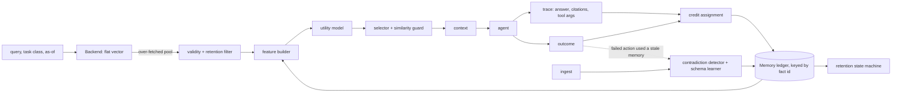

# ReMem: outcome-aware adaptive memory for long-horizon AI agents

ReMem is a memory layer that learns **which memories actually help an agent succeed**, and uses that to decide what to
retrieve, what to keep, what to supersede, and how much context to spend. It sits on top of a retrieval backend (a flat
vector index is built in; any backend implementing `remem.backends.base.Backend` can be plugged in).

> **Status: research prototype.** All numbers below come from a *synthetic, controlled benchmark with a simulated agent and an
> offline hash-based embedder*, not from a real LLM agent or a public memory benchmark. See [§11 Limitations](#11-limitations-read-these).
>
> **Novelty:** citation-based feedback on retrieval is prior art (RMM, arXiv 2503.08026, refines retrieval with online RL from the LLM's cited
> evidence), and Zep and Mem0's graph variant already keep superseded facts as invalid instead of deleting them. ReMem's contribution is the
> combination plus a controlled evaluation, not any single idea. See [docs/RELATED_WORK.md](docs/RELATED_WORK.md).

## What it adds to a retrieve-by-similarity memory

| Gap in a retrieve-by-similarity memory | ReMem's mechanism | Measured effect (this benchmark, 15 test seeds) |
|---|---|---|
| similarity is the only signal; look-alikes that never help keep winning | per-memory outcome ledger + utility model (transparent heuristic or learned logistic regression) | +13.8 pp task success over similarity-only retrieval, −9.5 tokens/task |
| replaced facts stay retrievable | supersession with validity intervals, `as_of` queries, outcome-triggered invalidation | stale-fact-in-context 39–54% of tasks → 0%; historical queries keep working |
| no safe way to retire or shrink memory | explicit state machine `ACTIVE → LOW_VALUE → COMPRESSED → ARCHIVED`, `INVALIDATED`; nothing deleted | safe for rarely-needed memories where frequency pruning destroys them (82% → 8% success) |
| context cost ignored | expected-utility knapsack under a token budget | −9.5 tokens/task; +2.1 pp from this step alone |
| correct memories sometimes pushed out by the utility layer | similarity guard | targeted failure 2.0% → 0.7% of tasks; success change within noise |
| single-valued attributes must be declared by hand | schema learned from outcome evidence | recovers about half the gap when no schema is given |
| credit assignment is cheap but imprecise | leave-one-out only on ambiguous memories | 82.4% vs 76.4% success for 0.41 extra agent calls/task |
| citation-feedback prior art (RMM) | RMM-style reranker reimplemented as a baseline | within noise of plain similarity here (63.1% vs 62.6%) |
| no way to plug into agents | Python API, MCP server, LangChain retriever, HTML dashboard | tested end to end (MCP over the real protocol) |

## Quickstart

```bash
pip install .                       # core: numpy, pyyaml, matplotlib
pip install ".[all]"                # optional extras: mcp, sentence-transformers, faiss, chroma, tiktoken, openai
python examples/quickstart.py       # 2-second demo: supersession, demotion, credit
```

### Python API

```python
from remem import ReMem

mem = ReMem("~/.remem/myproject")                    # persistent; reloads automatically
mem.add("The billing service exposes API version v1.", entity="billing", attribute="api_version")
mem.add("The billing service exposes API version v2.", entity="billing", attribute="api_version")  # supersedes v1

hits = mem.search("Which API version does billing expose?", task="api")
for h in hits.items:
    print(h.id, h.score, h.text)                     # only the v2 fact is served
# ... your agent acts on hits.items ...
mem.feedback(hits.search_id, success=True, used_ids=[hits.items[0].id])   # closes the loop

mem.inspect(hits.items[0].id)                        # state, credit, lifecycle, supersession links
mem.search("...", as_of=some_unix_time)              # ask about the past: superseded facts come back
```

Facts with the same `entity` + `attribute` and role `"state"` (the default) replace each other; store multi-valued things
(likes, dependencies) with `role="preference"` or `"note"` to keep them all. `mem.add_conversation(raw_text, extractor=...)` turns a
transcript into facts (see *Fact extraction* below).

### As an MCP server (Claude Code, Claude Desktop, any MCP client)

```bash
pip install ".[mcp]"
claude mcp add remem -- remem-mcp            # Claude Code
```

Claude Desktop, `claude_desktop_config.json`:

```json
{"mcpServers": {"remem": {"command": "remem-mcp", "env": {"REMEM_PATH": "C:/Users/you/.remem/work", "REMEM_EMBEDDER": "sentence-transformers"}}}}
```

Tools: `remember`, `recall`, `feedback`, `inspect`, `list_memories`, `stats`. The tool descriptions tell the agent to call `feedback` after
using a `recall` result. **If the agent never calls it, ranking stays similarity-only.** Environment: `REMEM_PATH` (store directory,
default `~/.remem/default`), `REMEM_EMBEDDER` (`hash` default, or `sentence-transformers`), `REMEM_ST_MODEL`.

### Embeddings and vector stores

```python
from remem import ReMem
from remem.embedders import SentenceTransformerEmbedder      # pip install sentence-transformers
from remem.backends import FaissBackend, ChromaBackend        # pip install faiss-cpu / chromadb

emb = SentenceTransformerEmbedder("all-MiniLM-L6-v2")
mem = ReMem("~/.remem/app", embedder=emb, backend=FaissBackend(emb))
```

The built-in hash embedder (`remem.offline.ConceptHashEmbedder`) exists for tests and the synthetic benchmark; use a real model in practice.
`remem.llm.OpenAIEmbedder` wraps any OpenAI-compatible embeddings endpoint. Any object with `ingest(facts)` and `candidates(query, k)`
works as a backend.

### Fact extraction

```python
from openai import OpenAI
from remem.extract import LLMFactExtractor
mem.add_conversation(transcript, extractor=LLMFactExtractor(OpenAI(), model="gpt-4o-mini"))
```

Without an extractor, `add_conversation` stores each sentence as a note (no automatic supersession). The LLM extractor is tested against a
fake client only; its extraction quality with a real model has not been measured here.

### LangChain

```python
from remem.integrations.langchain import ReMemRetriever      # pip install langchain-core
retriever = ReMemRetriever(memory=mem, k=5, task="support")
docs = retriever.invoke("Which plan is the customer on?")
retriever.feedback(success=True, used_ids=[docs[0].metadata["id"]])
```

### Dashboard, inspector, tokenizer

```bash
python -m remem.viz.dashboard ~/.remem/myproject -o memory.html          # self-contained HTML; open in a browser
python -m remem.viz.ledger_cli ~/.remem/myproject/ledger.json --list --state LOW_VALUE
```

Token budgets use a word+punctuation proxy by default; `remem.offline.set_tokenizer("tiktoken")` (or `REMEM_TOKENIZER=tiktoken`) switches
to real BPE counts.

### Running with a real LLM or on LongMemEval (needs your API key / data)

```bash
OPENAI_API_KEY=... python experiments/run_llm_agent.py --model <chat-model>                  # synthetic tasks, real LLM agent
python experiments/run_longmemeval.py --data longmemeval_s_cleaned.json --embedder st       # retrieval recall, no LLM needed
python experiments/run_longmemeval.py --data ... --qa --model <chat-model>                  # + answers for the official judge
```

Neither has been run in this repository: no API key was available and the dataset download was blocked from the development machine.

## Contents
1. [Problem](#1-problem) · 2. [Architecture](#2-architecture) · 3. [Utility model](#3-memory-utility-model) · 4. [Outcome feedback and credit assignment](#4-outcome-feedback-and-credit-assignment) · 5. [Adaptive retention](#5-adaptive-retention) · 6. [Contradiction and staleness](#6-contradiction-and-staleness) · 7. [Cost-aware retrieval](#7-cost-aware-retrieval) · 8. [Additional mechanisms](#8-additional-mechanisms) · 9. [Evaluation methodology](#9-evaluation-methodology) · 10. [Results](#10-results) · 11. [Limitations](#11-limitations-read-these) · 12. [Failure analysis](#12-failure-analysis) · 13. [Future work](#13-future-work) · [Related work](docs/RELATED_WORK.md)

## 1. Problem

Long-horizon agents accumulate thousands of memories. Which to show, keep, shrink or retire depends on whether they
*help the agent succeed*, which similarity cannot tell you: a memory can be close to every query and never useful; another can be
rarely needed and indispensable; a third can be correct once and false after a migration.

## 2. Architecture



| Module (`remem/`) | Role |
|---|---|
| `ledger.py`, `types.py` | per-memory state, statistics, validity, lifecycle events; JSON persistence |
| `features.py`, `utility.py` | feature groups; transparent heuristic and L2 logistic regression |
| `attribution.py` | credit assignment: presence / signals / signals + leave-one-out (all or ambiguous-only) |
| `contradiction.py` | supersession, validity intervals, volatile-attribute confidence decay, outcome-triggered invalidation, schema learning |
| `retention.py` | the state machine and revival |
| `selection.py`, `system.py` | rank packing vs knapsack; `ReMemSystem.ingest / retrieve / observe`; guard and exploration |
| `backends/` | `Backend` protocol and the flat-vector backend |
| `offline.py` | deterministic hash embedder with synonym lexicon (offline benchmark/tests) |
| `eval/` | seeded world generator, simulated agent, runner, metrics, failure analysis, report |
| `llm.py` | OpenAI-compatible agent and embedder adapters (unverified, see §8) |
| `viz/ledger_cli.py` | developer inspector |
| `api.py` | `ReMem`: the high-level, persistent API (`add`, `search`, `feedback`, `inspect`, `add_conversation`) |
| `mcp_server.py` | MCP server (`remem-mcp`) exposing remember / recall / feedback / inspect |
| `embedders.py`, `backends/stores.py` | sentence-transformers embeddings; FAISS and Chroma backends |
| `extract.py`, `integrations/langchain.py` | LLM fact extraction; LangChain retriever |
| `baselines/rmm.py` | RMM-style reranker used as a comparison baseline (reimplementation) |
| `viz/dashboard.py` | self-contained HTML dashboard |

## 3. Memory utility model

Target: `P(memory contributes to a successful outcome | features at retrieval time)`. Four feature groups let ablations switch
information sources off: **static** (similarity, gap to best, backend rank, recency, confidence, token cost), **history**
(retrieval count/recency, the "frequency" strawman), **outcome** (Beta-posterior contribution rate overall and per task class,
waste rate, blame rate, posterior std), **contradiction** (stale flag, contradiction count).

* `HeuristicUtility`: documented weighted sum (weights are design choices, listed in `utility.py`).
* `LearnedUtility`: L2 logistic regression (numpy Newton/IRLS, deterministic) trained on traces from **disjoint training worlds**; labels
  are *observed* (attributed credit ≥ 0.5 on a successful task), never ground truth; regularisation by leave-one-seed-out CV
  (`results/models/train_report.json`).
* Exploration: `+ c·posterior_std` (UCB-style) by default; Thompson sampling is available (§8).

## 4. Outcome feedback and credit assignment

`retrieve → agent acts → success/failure → credit assignment → ledger update → retention`. Only **shown** memories receive feedback
(bandit feedback), so retention reacts to evidence of uselessness *when shown*, never to low retrieval frequency.

Credit uses observable signals only: whether the agent **cited** the memory (self-reported, noisy) and whether the memory
**contains a value the agent committed to**. Credit is per memory (not split equally); failures assign *blame* to memories whose
value was used. Optional **leave-one-out replay** upgrades memories whose removal flips success to failure. Stated limitations:
citations are self-reported; value use is lexical (a decoy mentioning the answer counts); LOO needs a replayable agent and
under-credits redundant copies; none of it establishes causality.

## 5. Adaptive retention

States `ACTIVE, LOW_VALUE, COMPRESSED, ARCHIVED, INVALIDATED`; every transition is logged with its reason; nothing is deleted
(`original_text` is kept). Transitions depend on the posterior contribution rate and the number of *exposures*; demotions apply
per task class ("useless for deploys" ≠ "useless for approvals"); credited use revives; memories with accumulated credit cannot be
archived. A frequency-prune **control** exists only to show what this design avoids.

## 6. Contradiction and staleness

At ingest, two state-asserting facts conflict when they share an `(entity, attribute)` key and differ in *value-bearing* tokens.
Single-valued attributes supersede on key match; otherwise explicit update wording ("migrated", "no longer") is required. The old
fact gets `valid_to` and state `INVALIDATED`; it is excluded from default retrieval but returned for historical `as_of`
queries. A failed action that used memory M while a newer same-key fact exists supersedes M (outcome-triggered). Confidence decays
only for attributes observed to change, so old-but-true facts are not punished for age.

## 7. Cost-aware retrieval

Candidates with predicted `p < p_floor` are not worth context; under a hard token budget an exact 0/1 knapsack maximises Σp subject
to count and token limits. Tokens are a word+punctuation proxy, not a real tokenizer. Additivity of expected utility is an
approximation (a task needing two memories only succeeds with both).

## 8. Additional mechanisms

Each was tested and measured; results (including those that did not help) are in §10.

1. **Similarity guard** (`selection.guard_top`, default 3): the top-m most similar candidates are always served unless the ledger has
   evidence they are useless for this task class (shown ≥ 3 times, class contribution rate < 0.2). Targets a measured failure: the
   utility layer pushing a correct, highly similar memory out of context. `guard_top=3` was chosen on dev seeds.
2. **Thompson sampling** as an alternative exploration rule (`utility.explore_mode: thompson`). **Worse than the default UCB bonus**
   at every strength tried, so it is not the default.
3. **Learned single-valued-attribute schema** (`contradiction.learn_schema`): an attribute becomes single-valued after ≥ 2 outcome
   confirmations (failed actions that used a stale value, or explicit replacement wording) with posterior ≥ 0.6; counter-evidence
   (an older value still credited after a newer one arrived) blocks it. Pending conflicts are superseded retroactively.
4. **Cheaper leave-one-out** (`attribution.loo_policy: ambiguous`): replay only memories where exactly one of cited/used holds.
5. **LLM adapters** (`remem/llm.py`, `experiments/run_llm_agent.py`): `LLMAgent` (OpenAI-compatible chat, JSON answers + citations) and
   `OpenAIEmbedder`. **Not verified against a live endpoint**; covered by fake-client unit tests only. No reported number uses them.

## 9. Evaluation methodology

* **Shared candidate pool.** Every system consumes the identical over-fetched pool per query (replayed from a cache); differences come
  only from ranking, selection and lifecycle. Reported latency = pool time + the system's own re-ranking time.
* **Systems.** A flat vector, similarity only · B flat vector + static score (similarity + recency + confidence) · C ReMem ·
  cumulative ablation · leave-one-out · attribution variants · retention control.
* **Tasks** (`remem/eval/world.py`, seeded; ground truth hidden from the memory layer): `distractor`, `long_horizon`, `contradiction`,
  `rare_critical` (dormant and shown-elsewhere critical memories), `useless_frequent`, `budget_tight`/`budget_medium`, `state_change`
  (with historical `as_of` queries), and a **control**, `distractor_norecur`, where no (entity, attribute) pair recurs so per-memory
  history cannot help.
* **Agent.** A deterministic *simulated* reader with position-biased (`first`) and timestamp-aware (`latest`) modes, distraction
  proportional to irrelevant context, chance-level guessing and noisy self-citation. Everything is reported for both modes.
* **Seeds.** Train 100–103 (fit utility model), dev 200–201 (sanity checks, choosing `guard_top`, tuning the RMM-style baseline), **test 0–14 (all reported numbers)**.
  Means with 95% t-intervals over seeds; paired differences over seeds. The whole pipeline is deterministic.

```bash
python -m pip install -r requirements.txt
python -m pytest tests -q                      # 77 tests, under a minute
python experiments/run_benchmark.py --quick    # smoke run
python experiments/run_benchmark.py            # full protocol, 15 seeds; trains the model if missing (~20 min, 12 workers; resumable)
python experiments/demo_ranking.py             # "more similar vs more useful" demonstration
python -m remem.viz.ledger_cli results/runs/distractor_seed0_C_remem/ledger.json --list --state LOW_VALUE
```

## 10. Results

**15 test seeds**, mean ± 95% t-interval, simulated agent, offline hash embedder. Full generated tables:
[`results/RESULTS.md`](results/RESULTS.md); aggregates: `results/{baseline,static,remem,ablation,new_features,sensitivity}.json`; plots: `results/plots/`.

### Headline (mean over 7 core families)

| System | Task success % (reader `first`) | (`latest`) | Gold recall % | Context precision % | Tokens/task |
|---|---:|---:|---:|---:|---:|
| A flat vector, similarity only | 62.6 ± 2.4 | 70.7 ± 2.1 | 81.5 | 17.3 | 47.3 |
| B flat vector + static score | 65.9 ± 2.4 | 70.8 ± 2.1 | 81.7 | 17.3 | 47.4 |
| RMM-style reranker (our reimplementation, see below) | 63.1 ± 1.9 | 70.7 ± 1.9 | 80.7 | 17.1 | 44.5 |
| **C ReMem** | **76.4 ± 1.8** | **76.4 ± 1.8** | 87.7 | 21.5 | **37.8** |

Paired over seeds: C − A = **+13.8 ± 1.8 pp** (`first`), **+5.6 ± 1.2 pp** (`latest`); C − B = +10.5 ± 1.8 / +5.5 ± 1.3 pp; tokens −9.5 ± 0.9 per
task. The ReMem layer adds a few milliseconds per query (Python; see `results/RESULTS.md` for latency).

**Read the `first`/`latest` gap before the headline.** A timestamp-aware reader already copes with most stale facts, so the gain
shrinks from 13.8 to 5.6 pp. Most of the `first`-reader gain is contradiction handling.

### Per family (task success %, reader `first`)

| System | distractor | long_horizon | contradiction | rare_critical | useless_frequent | budget_tight | state_change | *distractor_norecur (control)* |
|---|---:|---:|---:|---:|---:|---:|---:|---:|
| A similarity only | 73.5 | 73.5 | 52.6 | 74.9 | 76.0 | 41.0 | 46.6 | 68.8 |
| B + static score | 73.5 | 73.5 | 63.3 | 74.9 | 75.8 | 41.0 | 59.3 | 68.7 |
| **C ReMem** | 79.3 | 79.9 | 82.4 | 81.6 | 79.9 | 49.5 | 82.0 | **68.7** |

With 15 seeds the per-family intervals are ±2 to ±8 pp, and ReMem is ahead of similarity-only on every core family. On the control,
where per-memory history cannot help, **ReMem gives no gain (68.7 vs 68.8)**. `budget_tight` stays low for every system because long gold
facts rank poorly on similarity and nearly fill the 45-token budget.

### Cumulative ablation (reader `first`, core families)

| System | Task success % | Tokens/task | Gold recall % |
|---|---:|---:|---:|
| flat vector baseline | 62.6 ± 2.4 | 47.3 | 81.5 |
| + temporal relevance | 65.9 ± 2.4 | 47.4 | 81.7 |
| + utility score (heuristic, retrieval-history features) | 64.0 ± 2.4 | 47.1 | 80.6 |
| + learned utility model (static + retrieval-history features) | **60.5 ± 2.3** | 46.9 | 75.3 |
| + outcome feedback | 66.3 ± 2.2 | 43.4 | 84.4 |
| + adaptive retention | 66.7 ± 2.0 | 42.2 | 85.0 |
| + contradiction handling | 73.9 ± 1.8 | 42.3 | 87.7 |
| + cost-aware selection (= full without similarity guard) | 75.8 ± 1.7 | 37.6 | 86.9 |

* **Retrieval frequency is not usefulness: measured.** Retrieval-history features, heuristic or learned, *lower* success (64.0, 60.5): in
  training traces frequently retrieved memories are mostly useful, so the model learns "frequent ⇒ useful", and look-alike traps are frequent too.
* Outcome-derived signals repair this (+5.8 pp, −3.5 tokens). **Contradiction handling is the largest single step (+7.2 pp)**, concentrated in
  the two families with updates. Leave-one-out from the full system agrees: removing contradiction handling −8.1 pp, outcome feedback −6.5,
  cost-aware selection −2.1, adaptive retention −1.4; removing the similarity guard changes success by −0.6 (within noise).
* **The learned model does not beat the transparent heuristic.** Full system with the heuristic utility: 76.8 ± 1.6 (learned 76.4 ± 1.8); AUC
  0.958 vs 0.954. The learned model's advantage is calibration (Brier 0.067 vs 0.092, ECE 0.150 vs 0.218), which matters for the cost-aware
  threshold, not ranking. AUC over considered candidates is 0.954 vs 0.876 for similarity alone.

### Credit assignment (same system, different attribution; reader `first`)

| Attribution | Task success % | Credit precision | Credit recall | Extra agent calls/task |
|---|---:|---:|---:|---:|
| presence (equal credit to everything in context) | 69.8 ± 2.2 | 0.19 | 1.00 | 0 |
| usage signals only, **outcome ignored** | 78.4 ± 1.5 | 0.52 | 1.00 | 0 |
| **signals (default)** | 76.4 ± 1.8 | 0.49 | 1.00 | 0 |
| signals + leave-one-out, all memories | 82.4 ± 1.7 | 1.00 | 0.82 | 2.34 |
| **signals + leave-one-out, ambiguous only** | **82.4 ± 1.4** | 0.99 | 0.96 | **0.41** |

Equal credit is worse than signal-based credit (69.8 vs 76.4). Ambiguous-only leave-one-out matches full leave-one-out for 82% fewer extra
agent calls. **Honest caveat on the name:** crediting purely from citation/value use while *ignoring* success/failure scores slightly *higher* than
the default (78.4 vs 76.4, overlapping intervals). In this benchmark the benefit comes from *usage* signals; the success bit gates credit and drives
blame and outcome-triggered invalidation, but we could not show it adds accuracy. Flipping 10% or 20% of outcome labels leaves ReMem at 76.5 / 76.9,
consistent with that.

### Comparison with an RMM-style reranker

RMM ([arXiv 2503.08026](https://arxiv.org/abs/2503.08026)) learns a reranker from the LLM's citations with REINFORCE. `remem/baselines/rmm.py`
reimplements its §6 (residual linear embedding adaptation, Gumbel sampling, +1/−1 citation reward); it is **not the authors' code**, its gradient
is verified numerically, and its learning rate and temperature were tuned on dev seeds. Here it scores **63.1%, within noise of plain similarity
(62.6%)**, and on dev seeds more learning made it worse. This says the RMM-style mechanism did not help *in this synthetic setting with hash
embeddings and ~300 tasks per world*; it says nothing about RMM as published (different data, real embeddings, Gemini, plus its Prospective
Reflection component, which is not reimplemented). Details: [`docs/RELATED_WORK.md`](docs/RELATED_WORK.md).

### Retention (`rare_critical`, reader `first`)

| System | Overall % | Dormant-critical % | Shown-elsewhere critical % | memories ARCHIVED |
|---|---:|---:|---:|---:|
| A similarity only (no retention) | 74.9 | 81.7 ± 8.2 | 74.2 ± 8.5 | 0 |
| C ReMem (adaptive retention) | 81.6 | 81.7 ± 8.2 | 73.3 ± 8.2 | 0.3 |
| **frequency-prune control** | 77.4 | **8.3 ± 5.0** | **33.3 ± 8.1** | **118.2** |

Frequency pruning archives about 60% of memory and destroys the rarely needed ones; the exposure/outcome-based policy leaves them untouched.
Adaptive retention itself engages rarely in these worlds (on average 6.0 LOW_VALUE, 0.6 COMPRESSED, 0.4 ARCHIVED of 207) and saves about 2% of
eligible tokens; **no accuracy benefit is claimed**.

### Contradiction and state change (reader `first`)

ReMem removes stale-memory-in-context events (`contradiction` 38.6% → 0.0% of tasks; `state_change` 53.6% → 0.0%), with **0 false invalidations**
(multi-valued `depends_on` facts are never superseded), and **0 missed** given the single-valued-attribute schema. Historical (`as_of`) queries:
78.6% vs 48.1% for similarity-only. With 20% of facts losing their attribute key (imperfect extraction) ReMem still reaches 70.4% vs 48.7% for
similarity-only (static score: 55.9%) on the two update families.

**Learned schema (none given), 15 seeds.** Stale-in-context task rate / missed invalidations per world / success:

| Setting | no schema | learned schema | schema given |
|---|---:|---:|---:|
| `state_change`, explicit update wording | 7.8% / 2.6 / 78.2 | 3.2% / 0.5 / 80.2 | 0.0% / 0 / 82.0 |
| `state_change`, **no** update wording | 11.2% / 5.1 / 77.3 | 4.5% / 1.2 / 79.8 | 0.0% / 0 / 82.3 |
| `contradiction`, explicit wording | 2.7% / 0.7 / 81.1 | 1.7% / 0.3 / 81.6 | 0.0% / 0 / 82.4 |
| `contradiction`, no wording | 5.9% / 1.7 / 79.2 | 4.5% / 0.7 / 79.6 | 0.0% / 0 / 80.2 |

Learning recovers about half of the gap to a hand-written schema where the gap is largest (`state_change` without wording: +2.5 pp, 76% of the missed
invalidations removed), and is within noise on `contradiction`. It never produced a false invalidation.

### Guard and exploration (core families, reader `first`)

| System | Task success % | Tasks where utility pushed out a top-5-similar gold % | Tokens/task |
|---|---:|---:|---:|
| A similarity only | 62.6 | 0.4 | 47.3 |
| full without guard | 75.8 ± 1.7 | **2.0** | 37.6 |
| **C ReMem (guard_top=3)** | 76.4 ± 1.8 | **0.7** | 37.8 |
| full with Thompson instead of UCB | 74.7 ± 1.8 | 0.9 | 40.8 |

The guard does what it was built for (that failure drops by ~65%); its effect on task success (+0.6 pp) is within noise. Thompson sampling is worse
than UCB (−1.7 pp, +3 tokens/task).

### Robustness (core families, `first`)

| Perturbation | A | B | C |
|---|---:|---:|---:|
| none | 62.6 | 65.9 | 76.4 |
| agent not distracted by irrelevant context (0 per item) | 73.8 | 77.5 | 88.1 |
| agent twice as distractible (0.10 per item) | 51.6 | 54.5 | 64.6 |
| 20% of outcome labels flipped | 62.6 | 65.9 | 76.9 |

The absolute level moves a lot with the assumed cost of wasted context; ReMem's lead over similarity-only does not (+14.3 / +13.0 pp).

### Ranking demonstration and lifecycle

`python experiments/demo_ranking.py` writes `results/demo_ranking.md`: tasks where a look-alike with higher similarity is **not** served while a
lower-similarity gold memory is (104 such tasks in the first test world). `python -m remem.viz.dashboard <store>` renders every memory's state,
credit, supersession links and lifecycle as a self-contained HTML page; `python -m remem.viz.ledger_cli` is the terminal equivalent. Per-feature
"utility components" come from a regression with correlated features, so individual component signs can be large and opposite; read them as a
decomposition of the score, not as independent effects.

## 11. Limitations (read these)

* **No real-LLM and no public-benchmark evidence yet.** The LLM agent and LongMemEval runners exist (`experiments/run_llm_agent.py`,
  `experiments/run_longmemeval.py`) but were not run: no API key was available and the dataset download was blocked from the development machine.
  **No number in this repository is from a public benchmark or a real LLM.** The reader is deterministic and simulated; its distraction strength
  (0.05 per irrelevant item) and chance-guessing are assumptions, and the cost-aware gain depends on "wasted context hurts".
* **On LongMemEval-style data, expect little from ReMem.** Each question there has its own history and is asked once, so per-memory feedback never
  accumulates, and raw turns carry no entity/attribute keys for supersession (without LLM extraction). This is the same situation as the
  `distractor_norecur` control, where ReMem shows no gain.
* **Offline hash embedder in the benchmark.** Hash embeddings with a hand-written synonym lexicon replace a trained embedding model; about 3% of gold
  facts are never retrieved at all (the embedder has no stemming). Real embeddings are supported (`SentenceTransformerEmbedder`) but the benchmark
  numbers do not use them.
* **Only flat vector stores are built in** (numpy, FAISS, Chroma). An earlier version also compared against a hierarchical-memory backend; that
  backend and every comparison against it were removed, so no claim here concerns any hierarchical memory system.
* **Synthetic, author-designed tasks.** They exercise the mechanisms and some (traps, repeated pairs) favour per-memory history by construction; the
  control family and the negative results are included for that reason. Gains require *recurring* queries.
* **Extraction is assumed in the benchmark.** The detector uses `entities`, `attribute_keys` and `semantic_role` fields as an LLM extractor would emit;
  there they come from the generator (noise sensitivity above). `LLMFactExtractor` exists but its quality with a real model is unmeasured.
* **Library supersession rule.** Through `ReMem.add`, two `"state"` facts with the same entity and attribute replace each other; a multi-valued
  attribute stored as `"state"` would lose values. Store those as `"preference"` or `"note"`.
* **Feedback only on shown memories** (bandit feedback); exploration is a heuristic; memories never shown never get labels. In the MCP server, learning
  only happens if the agent actually calls `feedback`.
* **Credit assignment is not causal.** Default credit precision is only 0.49; leave-one-out fixes it at a cost of extra agent calls (0.41–2.34/task).
* **The learned model does not beat the heuristic**; it was trained on observed labels from a heuristic policy and deployed under another (distribution shift).
* **Several mechanisms did not help or are within noise:** retention (accuracy), similarity guard (success), Thompson sampling (worse), outcome gating
  (usage-only matches it), and the RMM-style reranker (within noise of similarity; our reimplementation, not the authors' code).
* **Statistics.** 15 seeds, t-intervals over seeds; worlds come from one author-written generator, so seeds are not independent real-world samples.
  Tokens are a word+punctuation proxy by default (`set_tokenizer("tiktoken")` for real counts).
* **Process disclosure.** Hyper-parameters were set a priori, except those chosen on dev seeds: `guard_top=3`, rejecting Thompson sampling, and the
  RMM-style baseline's learning rate and temperature. Dev seeds were also used for fixing defects found by unit tests (detector false positives, an LOO
  discount equal to the threshold, trap invalidation by the outcome path) and for raising critical tasks per world from 6+6 to 8+8. The test seeds were run
  several times as the code changed; the reported numbers are from the final run only.

## 12. Failure analysis

[`results/failure_analysis.md`](results/failure_analysis.md) (+ `failures.jsonl`): per-task tags, all 15 test seeds, reader `first`.

| Category | A similarity only | C ReMem |
|---|---:|---:|
| `gold_not_in_pool` (backend never offered it) | 3.1% | 3.1% |
| `gold_pooled_not_selected` | 19.8% | 11.3% |
| `utility_demoted_gold` (top-5 by similarity, pushed out) | 0.6% | 0.7% |
| `useful_filtered` (archived/invalidated although needed) | 0 | 0 |
| `irrelevant_retrieved` (failed + distracted) | 18.5% | 16.1% |
| `outdated_preferred` | 8.6% | **0.0%** |
| `success_without_memory` (lucky guess) | 4.4% | 2.7% |
| `fail_despite_gold` (all gold served, still failed) | 20.4% | 13.2% |

What the system still gets wrong: (1) the utility layer still pushes out a highly similar correct memory in 0.7% of tasks (2.0% without the guard);
(2) irrelevant context still causes 16% of failures; (3) 3.1% of gold facts are never in the pool, a limitation of the offline embedder; (4) about one task
in eight fails with every needed memory present, because the simulated agent can be distracted.

## 13. Future work

Run the LLM-agent and LongMemEval runners with a real model and the real data (both are ready; see Quickstart); measure how well an LLM's
self-citations track real dependence; evaluate `LLMFactExtractor` quality; let per-memory utility generalise to unseen memories (the RMM idea of
adapting the embedding space, combined with ReMem's outcome gating); off-policy correction for the learned model; more backends (Qdrant, pgvector).

## Repository map

```
remem/                 the library: api.py (ReMem), mcp_server.py, system.py, ledger, utility, attribution, contradiction, retention, selection
remem/backends/        numpy vector, FAISS, Chroma            remem/embedders.py   sentence-transformers
remem/extract.py       fact extraction                         remem/integrations/  LangChain retriever
remem/baselines/       RMM-style reranker (reimplementation)  remem/viz/           dashboard (HTML), ledger_cli
remem/eval/            synthetic worlds, simulated agent, runner, metrics, failure analysis, report
experiments/           run_benchmark.py, train_utility.py, tune_rmm.py, demo_ranking.py, run_llm_agent.py, run_longmemeval.py
examples/quickstart.py configs/systems.yaml (every compared system)      tests/ (77 tests)
results/               RESULTS.md, failure_analysis.md, *.json, plots/, runs/<…>/ledger.json, models/, records/
docs/                  DESIGN.md, RELATED_WORK.md                .github/workflows/  CI
```

License: MIT (see `LICENSE`). © 2026 Viswesh Kesarla.

## Acknowledgement

Motivated by gaps observed in the MemForest agent-memory system (Chen et al.): https://github.com/Concyclics/MemForest
